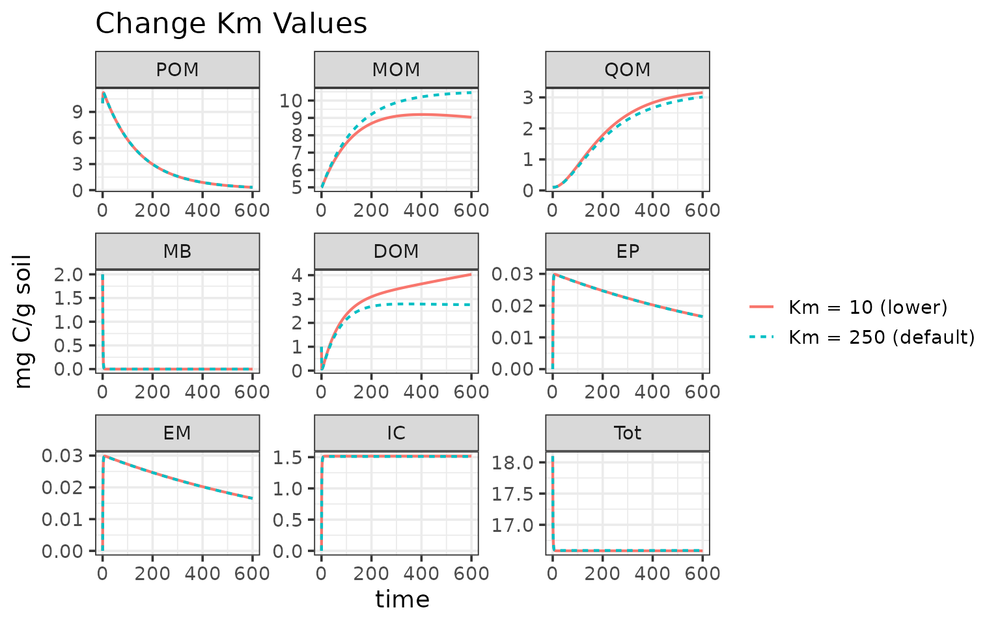
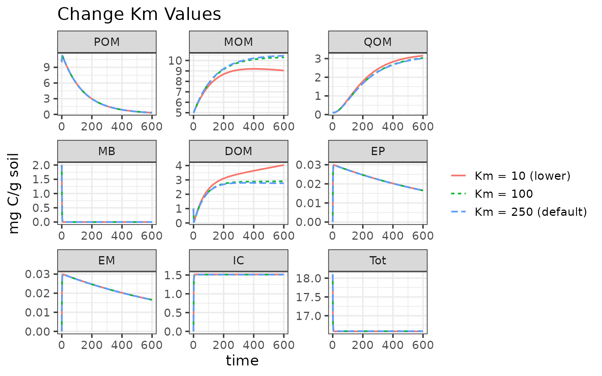

# Change Model Parameters

This example will show how to update the model parameter values for any
MEMC model configuration.

``` r
# Assumes MEMC has already been installed. 
library(MEMC) 
```

The `MEMC` package includes default parameter and initial pool values
that are included as package data that are based on Wang et
al. 2015[¹](#fn1). This example will use these values and show users how
to update these values. We will also be running the MEMC MEND model
configuration.  

## Default Parameters

Start by taking a look at the default model parameter values.

``` r
print(memc_initial_state)
#>      POM      MOM      QOM       MB      DOM       EP       EM       IC 
#> 10.00000  5.00000  0.10000  2.00000  1.00000  0.00001  0.00001  0.00000 
#>      Tot 
#> 18.10002
# Alternatively can use the :: to access the MEMC package data. 
# print(MEMC::memc_initial_state)
```

``` r
print(memc_params)
#>    parameter                                              description
#> 1        V_p        maximum specific decomposition rate for POM by EP
#> 2        K_p        half-saturation constant for decomposition of POM
#> 3        V_m        maximum specific decomposition rate for MOM by EM
#> 4        K_m        half-saturation constant for decomposition of MOM
#> 5        V_d       maximum specific uptake rate of D for growth of MB
#> 6        K_d half-saturation constant of uptake of D for growth of MB
#> 7        f_d                fraction of decomposed P allocated to DOM
#> 8        g_d                      fraction of dead B allocated to DOM
#> 9       p_ep                      fraction of mR for production of EP
#> 10      p_em                      fraction of mR for production of EM
#> 11      r_ep                                      turnover rate of EP
#> 12      r_em                                      turnover rate of EM
#> 13     Q_max                            maximum DOC sorption capacity
#> 14     K_ads                                 specific adsorption rate
#> 15     K_des                                          desorption rate
#> 16   dd_beta            strength of density dependent microbial decay
#> 17 Input_POM                                               POM input 
#> 18 Input_DOM                                                DOM input
#> 19       CUE                                    carbon use efficiency
#>              units   value
#> 1  mgC mgC^-1 d^-1  14.000
#> 2     mgC / g soil  50.000
#> 3  mgC mgC^-1 d^-1   0.250
#> 4      mg C/g soil 250.000
#> 5  mgC mgC^-1 d^-1   3.000
#> 6      mg C/g soil   0.250
#> 7             <NA>   0.500
#> 8             <NA>   0.500
#> 9             <NA>   0.010
#> 10            <NA>   0.010
#> 11 mgC mgC^-1 d^-1   0.001
#> 12 mgC mgC^-1 d^-1   0.001
#> 13    mgC / g soil   3.400
#> 14 mgC mgC^-1 d^-1   0.006
#> 15 mgC mgC^-1 d^-1   0.001
#> 16            <NA>   1.000
#> 17            mg C   0.000
#> 18            mg C   0.000
#> 19                   0.400
# Alternatively can use the :: to access the MEMC package data. 
# print(MEMC::memc_params)
```

## Run deafult MEMC MEND

Run the pre-configured MEMC MEND model with the default parameter
values.

``` r
time <- 0:600 
mod1 <- MEND_config
out1 <- memc_solve(mod = mod1, time = time)
out1$name <- "Km = 250 (default)"
```

## Update parameter value

Users can update the parameters directly via `memc_solve`. Any
parameter(s) value(s) fed into the `memc_solve` params argument will
overwrite the parameter values defined the model configuration.

``` r
out2 <- memc_solve(mod = MEND_config, time = time, params = c("K_m" = 10))
out2$name <- "Km = 10 (lower)"
```

``` r
ggplot(data = rbind(out1, out2)) + 
  geom_line(aes(time, value, color = name, linetype = name), linewidth = 0.75) + 
  facet_wrap("variable", scales = "free") + 
  labs(y = "mg C/g soil", 
       title = "Change Km Values") +
  theme(legend.title = element_blank())
```



## Update parameter table using `memc_update_params`

`memc_update_params` is a helper function that can change the parameter
values in the parameter table. You will need to set up a new model
configuration with the new parameter table.

``` r
new_km <- memc_update_params(new_params = c("K_m" = 100), param_table = memc_params)

# Set up the new model configuration with the 
mod_km <- memc_configure(params = new_km, 
                        state = memc_initial_state,
                        name = "Km = 100", 
                        DOMuptake = "MM",
                        POMdecomp = "MM",
                        MBdecay = "LM")

out3 <- memc_solve(mod = mod_km, time = time)
```

``` r
ggplot(data = rbind(out1, out2, out3)) + 
  geom_line(aes(time, value, color = name, linetype = name), linewidth = 0.75) + 
  facet_wrap("variable", scales = "free") + 
  labs(y = "mg C/g soil", 
       title = "Change Km Values") +
  theme(legend.title = element_blank())
```



------------------------------------------------------------------------

1.  Wang, G., Jagadamma, S., Mayes, M. et al. Microbial dormancy
    improves development and experimental validation of ecosystem model.
    ISME J 9, 226–237 (2015). <https://doi.org/10.1038/ismej.2014.120>
