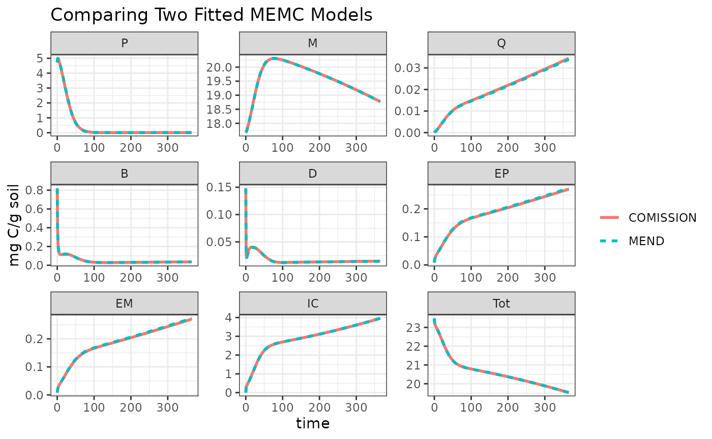

# Fit model to data

This example demonstrates how to use `memc_modfit` to fit a MEMC model
configuration to observational data. In this example we will be fitting
the MIMCS model to the data from CITATION EXPERIMENT.

## Setup

``` r
# This assumes that the MEMC package has already been installed. 
library(MEMC)

# Used to visualize results
library(ggplot2)  
theme_set(theme_bw() + theme(legend.title = element_blank()))
```

Start by loading the comparison data, included in the package data.

``` r
comp_data <- memc_incubation_ultisol$data[c(1, 3)]
names(comp_data) <- c("time", "IC")
```

Set up the the MIMCS model with different initial pool sizes to be
consistent with the experiment setup.

``` r
# Save a copy of the mimics model configuration. 
my_mod_config <- MEMC::MIMCS_config

# Update the MEND model initial state conditions to reflect 
# the experimental setup
my_mod_config$state <- memc_incubation_ultisol$state
```

Run the model with the original parameter values.

``` r
original_rslts <- memc_solve(my_mod_config, time = 0:max(comp_data$time))
```

Use `memc_modfit` to fit the model to the observed data.

Description of inputs to MEMC function `memc_modfit` are as follows:

- config: a MEMC model configuration object, either one of the pre-built
  configurations listed in memc_all_configs or created using
  configure_config
- comp_data: a data frame containing the comparison data that the model
  will be fit to

``` r
fit <- memc_modfit(config = my_mod_config, 
                   comp_data = comp_data, 
                   x = c(V_d = 2, V_p = 5, V_m = 0.01))

fit$par
#>        V_d        V_p        V_m 
#>  4.8977714 31.3576003  0.3833364
```

Re run the model with the parameter values.

``` r
new_rslts <- memc_solve(my_mod_config, params = fit$par, time = 0:max(comp_data$time)) 
```

``` r
# Format into a single data table to plot
original_rslts$par <- "original values"
new_rslts$par <- "fitted values"
out <- rbind(original_rslts, new_rslts)
```

Plot the model results vs the comparison data:

``` r
ggplot(data = out[out$variable == "IC", ]) +
  geom_line(aes(time, value, color = par)) +
  geom_point(data = comp_data, aes(time, IC)) +
  facet_wrap("variable", scales = "free") + 
  labs(x = "Time (days)", y = "mg C/g soil", title = "MIMCS") 
```


