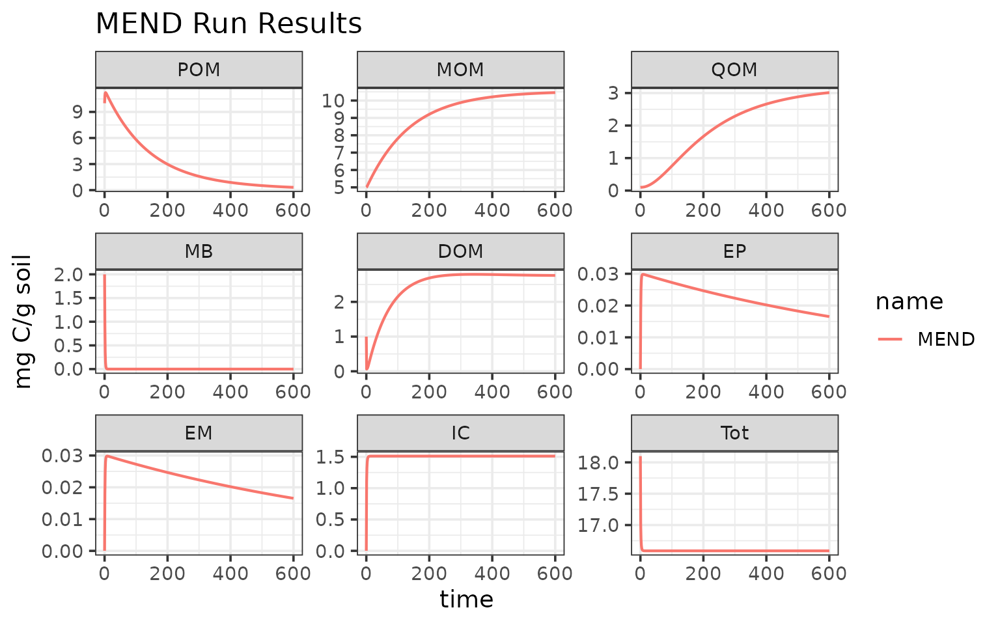
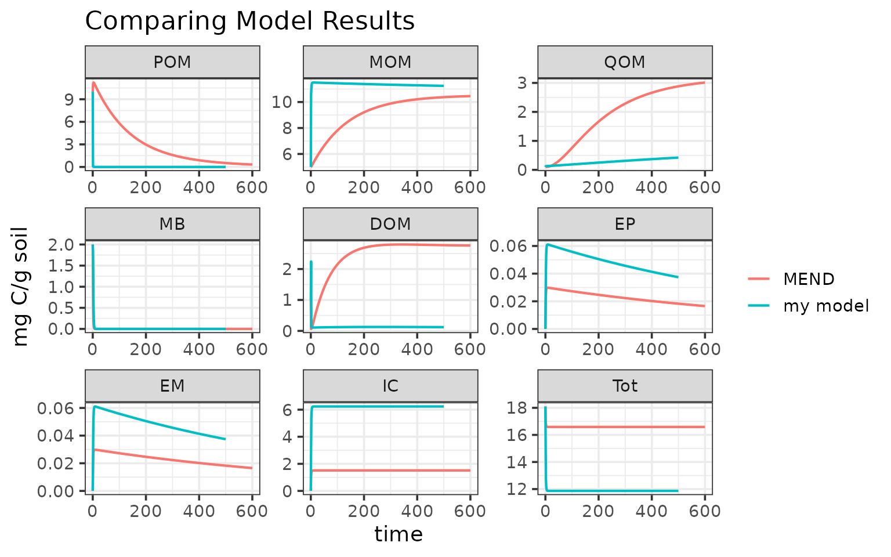

# MEMC

`MEMC` is a R package that allows users to explore various
representation of soil organic matter (SOM) flux dynamics within a
consistent SOM pool model structure.

## Installation

`MEMC` may be installed using the `install_github` function from the
`remotes` package.

``` r
# Install the remotes package if needed, and then
# remotes::install_github("Microbial-Explicit-Model/MEMC") 

# Load the installed MEMC package
library(MEMC)
```

## Example 1: Run `MEMC` MEND

The package ships with several already defined model configurations; use
[`help(configurations)`](https://microbial-explicit-model.github.io/MEMC/reference/configurations.md)
to see a list. Currently there are six configurations included as
internal MEMC package data, with each using different representations
for DOM uptake, POM decomposition, and MB decay.

All MEMC model configurations are listed in the `memc_all_configs` and
are listed in the summary table.

``` r
summary(memc_all_configs)
```

| model     | DOMuptake | POMdecomp | MBdecay |
|:----------|:----------|:----------|:--------|
| MEND      | MM        | MM        | LM      |
| COMISSION | MM        | RMM       | LM      |
| CORPSE    | RMM       | LM        | LM      |
| MEMS      | LM        | LM        | LM      |
| BAMS      | MM        | MM        | LM      |
| MIMCS     | MM        | MM        | DD      |

Let’s try using MEND, the microbial enzyme-mediated decomposition model
originally developed by [Wang et
al. 2014](https://doi.org/10.1371/journal.pone.0089252).

You can type
[`help("MEND_config")`](https://microbial-explicit-model.github.io/MEMC/reference/MEND_config.md)
for more details about the pre-built configuration.

``` r
# Printing this MEMC model configuration will return a list giving the 
# run name, a table of the flux dynamics, parameter values, and initial
# SOM pool sizes. 
print(MEND_config)
#> $name
#> [1] "MEND"
#> 
#> $table
#>   model DOMuptake POMdecomp MBdecay
#> 1  MEND        MM        MM      LM
#> 
#> $params
#>    parameter                                              description
#> 1        V_p        maximum specific decomposition rate for POM by EP
#> 2        K_p        half-saturation constant for decomposition of POM
#> 3        V_m        maximum specific decomposition rate for MOM by EM
#> 4        K_m        half-saturation constant for decomposition of MOM
#> 5        V_d       maximum specific uptake rate of D for growth of MB
#> 6        K_d half-saturation constant of uptake of D for growth of MB
#> 7        f_d                fraction of decomposed P allocated to DOM
#> 8        g_d                      fraction of dead B allocated to DOM
#> 9       p_ep                      fraction of mR for production of EP
#> 10      p_em                      fraction of mR for production of EM
#> 11      r_ep                                      turnover rate of EP
#> 12      r_em                                      turnover rate of EM
#> 13     Q_max                            maximum DOC sorption capacity
#> 14     K_ads                                 specific adsorption rate
#> 15     K_des                                          desorption rate
#> 16   dd_beta            strength of density dependent microbial decay
#> 17 Input_POM                                               POM input 
#> 18 Input_DOM                                                DOM input
#> 19       CUE                                    carbon use efficiency
#>              units   value
#> 1  mgC mgC^-1 d^-1  14.000
#> 2     mgC / g soil  50.000
#> 3  mgC mgC^-1 d^-1   0.250
#> 4      mg C/g soil 250.000
#> 5  mgC mgC^-1 d^-1   3.000
#> 6      mg C/g soil   0.250
#> 7             <NA>   0.500
#> 8             <NA>   0.500
#> 9             <NA>   0.010
#> 10            <NA>   0.010
#> 11 mgC mgC^-1 d^-1   0.001
#> 12 mgC mgC^-1 d^-1   0.001
#> 13    mgC / g soil   3.400
#> 14 mgC mgC^-1 d^-1   0.006
#> 15 mgC mgC^-1 d^-1   0.001
#> 16            <NA>   1.000
#> 17            mg C   0.000
#> 18            mg C   0.000
#> 19                   0.400
#> 
#> $state
#>      POM      MOM      QOM       MB      DOM       EP       EM       IC 
#> 10.00000  5.00000  0.10000  2.00000  1.00000  0.00001  0.00001  0.00000 
#>      Tot 
#> 18.10002
```

Perform a model run using the `memc_solve` function, whose inputs are:

- `mod`. A `MEMC` model object, either one of the model configurations
  included with the package or created using the
  [`memc_configure()`](https://microbial-explicit-model.github.io/MEMC/reference/memc_configure.md);
  and
- `times`. A numeric vector of the time sequence for which the model
  will be solved; the first value of times is the initial time.

``` r
mend_out <- memc_solve(mod = MEND_config, time = 0:600)
```

The model run results are saved in the `mend_out` data frame.

``` r
# Preview the run results
head(mend_out)
#>     time variable    value       units   name
#>    <num>   <fctr>    <num>      <char> <char>
#> 1:     0      POM 10.00000 mg C/g soil   MEND
#> 2:     1      POM 10.85536 mg C/g soil   MEND
#> 3:     2      POM 11.15375 mg C/g soil   MEND
#> 4:     3      POM 11.22363 mg C/g soil   MEND
#> 5:     4      POM 11.20608 mg C/g soil   MEND
#> 6:     5      POM 11.15458 mg C/g soil   MEND
```

Visualize the run results:

``` r
library(ggplot2)
ggplot(data = mend_out) + 
  geom_line(aes(time, value, color = name), linewidth = 0.75) + 
  facet_wrap("variable", scales = "free") + 
  labs(y = "mg C/g soil", 
       x = "time (days)", 
       title = "MEND Run Results")
```



## Example 2: Build your own model

With `MEMC`, users are able not only to easily run simulations with the
provided model configurations, but also build toy model of their own
design by selecting any combination of the supported flux dynamics. See
here for an example for how to use `memc_configure` to build your own
SOM model.

The `MEMC` package includes default parameter and initial pool values
that are included as package data that are based on Wang et al.
2015[¹](#fn1). This example will use these values.

Before setting up the model configuration, take a look at these
defaults:

``` r
print(memc_initial_state) # this is MEMC::memc_initial_state
#>      POM      MOM      QOM       MB      DOM       EP       EM       IC 
#> 10.00000  5.00000  0.10000  2.00000  1.00000  0.00001  0.00001  0.00000 
#>      Tot 
#> 18.10002
```

``` r
print(memc_params) # data(memc_params) or MEMC::memc_params
#>    parameter                                              description
#> 1        V_p        maximum specific decomposition rate for POM by EP
#> 2        K_p        half-saturation constant for decomposition of POM
#> 3        V_m        maximum specific decomposition rate for MOM by EM
#> 4        K_m        half-saturation constant for decomposition of MOM
#> 5        V_d       maximum specific uptake rate of D for growth of MB
#> 6        K_d half-saturation constant of uptake of D for growth of MB
#> 7        f_d                fraction of decomposed P allocated to DOM
#> 8        g_d                      fraction of dead B allocated to DOM
#> 9       p_ep                      fraction of mR for production of EP
#> 10      p_em                      fraction of mR for production of EM
#> 11      r_ep                                      turnover rate of EP
#> 12      r_em                                      turnover rate of EM
#> 13     Q_max                            maximum DOC sorption capacity
#> 14     K_ads                                 specific adsorption rate
#> 15     K_des                                          desorption rate
#> 16   dd_beta            strength of density dependent microbial decay
#> 17 Input_POM                                               POM input 
#> 18 Input_DOM                                                DOM input
#> 19       CUE                                    carbon use efficiency
#>              units   value
#> 1  mgC mgC^-1 d^-1  14.000
#> 2     mgC / g soil  50.000
#> 3  mgC mgC^-1 d^-1   0.250
#> 4      mg C/g soil 250.000
#> 5  mgC mgC^-1 d^-1   3.000
#> 6      mg C/g soil   0.250
#> 7             <NA>   0.500
#> 8             <NA>   0.500
#> 9             <NA>   0.010
#> 10            <NA>   0.010
#> 11 mgC mgC^-1 d^-1   0.001
#> 12 mgC mgC^-1 d^-1   0.001
#> 13    mgC / g soil   3.400
#> 14 mgC mgC^-1 d^-1   0.006
#> 15 mgC mgC^-1 d^-1   0.001
#> 16            <NA>   1.000
#> 17            mg C   0.000
#> 18            mg C   0.000
#> 19                   0.400
```

Set up the model configuration:

``` r
# Running memc_configure will print a table describing the model configuration. 
my_config <- memc_configure(params = memc_params, 
                            state = memc_initial_state, 
                            name = "my model", 
                            DOMuptake = "MM", 
                            POMdecomp = "LM", 
                            MBdecay = "LM")
```

Use `memc_solve` to run our model…

``` r
my_out <- memc_solve(mod = my_config, time = 0:500)
head(my_out)
#>     time variable        value       units     name
#>    <num>   <fctr>        <num>      <char>   <char>
#> 1:     0      POM 10.000000000 mg C/g soil my model
#> 2:     1      POM  0.078133991 mg C/g soil my model
#> 3:     2      POM  0.057178745 mg C/g soil my model
#> 4:     3      POM  0.025336371 mg C/g soil my model
#> 5:     4      POM  0.010945045 mg C/g soil my model
#> 6:     5      POM  0.004727821 mg C/g soil my model
```

…and compare our toy model results with the MEND results:



For more examples and tutorials please see our [online
documentation](https://microbial-explicit-model.github.io/MEMC/).

------------------------------------------------------------------------

1.  Wang, G., Jagadamma, S., Mayes, M. et al. Microbial dormancy
    improves development and experimental validation of ecosystem model.
    ISME J 9, 226–237 (2015). <https://doi.org/10.1038/ismej.2014.120>
