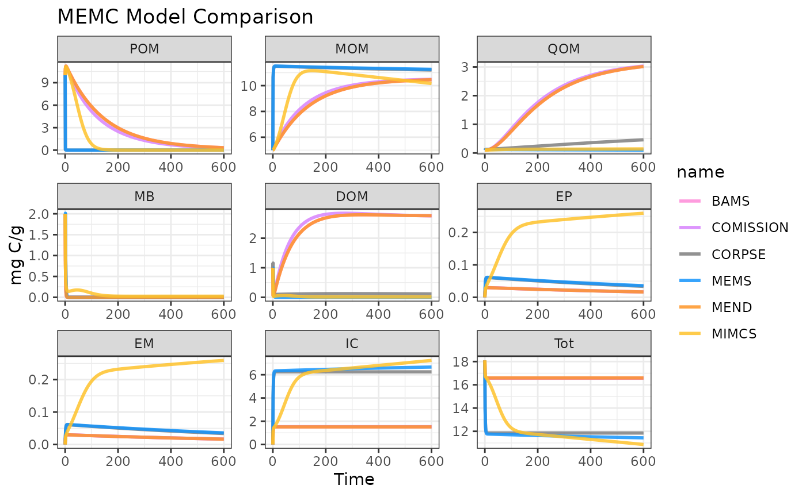

# Compare All MEMC Models

Compare all of the default results from the MEMC model configurations
included within the package. This example will show users how to run
MEMC model configurations and how to visualize the results.

Start by loading the package.

``` r
# This assumes that the package has already been installed, see installation instructions. 
library(MEMC)

# See https://ggplot2-book.org/ for more details on data visualization.
library(ggplot2)
theme_set(theme_bw())
```

Take look at the table of package model configurations.

``` r
summary(memc_all_configs)
```

| model     | DOMuptake | POMdecomp | MBdecay |
|:----------|:----------|:----------|:--------|
| MEND      | MM        | MM        | LM      |
| COMISSION | MM        | RMM       | LM      |
| CORPSE    | RMM       | LM        | LM      |
| MEMS      | LM        | LM        | LM      |
| BAMS      | MM        | MM        | LM      |
| MIMCS     | MM        | MM        | DD      |

Run all 6 model configurations using the `memc_solve` function

``` r
# Vector for the time steps
times <- seq(0, 600, by = 1)

# Solve all the model configurations
out_list <- lapply(memc_all_configs, memc_solve, time = times)

# Save all of the output in a single data frame for plotting. 
out <- do.call(rbind, out_list)
```

Visualize results!

``` r
plot(out)
```


