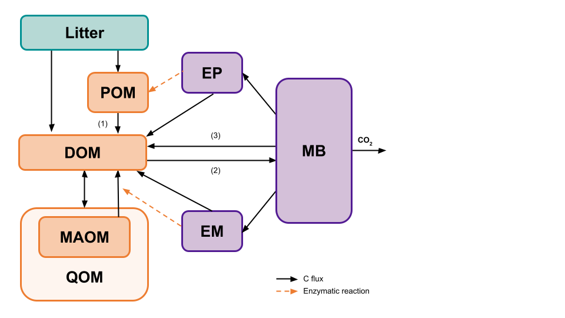
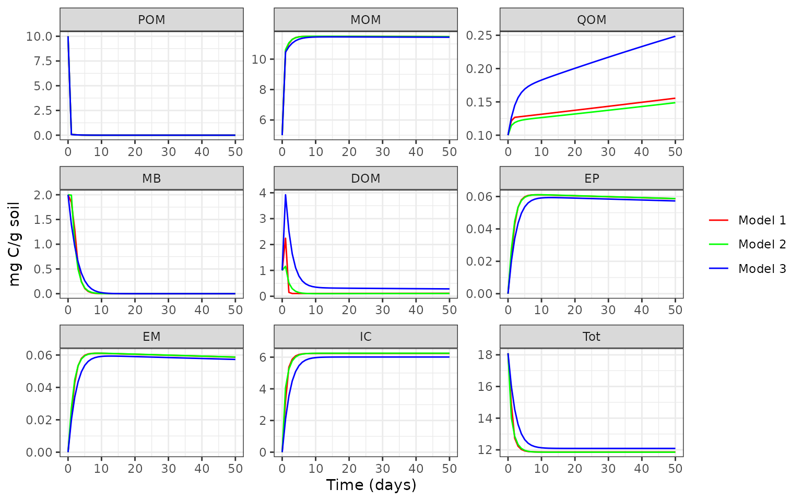

# Configure a MEMC Model

The `memc_configure` function allows users to build their own SOM model.
All of the MEMC models use the same SOM pool structure but users will be
able to decide which of the following dynamics.



The `memc_configure` function allows users to build their own SOM model.
All of the MEMC models use the same SOM pool structure but users will be
able to decide which of the formulations (LM, MM, RMM, ECA, or DD) are
used for POM decomposition (1), DOM uptake (2), and microbial biomass
decay (3). The following example will demonstrate how changing the DOM
uptake flux impacts the model projections.

Set up the model configuration using the default paramaters and inital
carbon pool values.

``` r
# Running memc_configure will print a table describing the model configuration. 
mod1 <- memc_configure(params = memc_params, 
                            state = memc_initial_state, 
                            name = "Model 1", 
                            DOMuptake = "MM", 
                            POMdecomp = "LM", 
                            MBdecay = "LM")
```

Take a look at all the details of the new model configuraiton

``` r
print(mod1)
#> $name
#> [1] "Model 1"
#> 
#> $table
#>     model DOMuptake POMdecomp MBdecay
#> 1 Model 1        MM        LM      LM
#> 
#> $params
#>    parameter                                              description
#> 1        V_p        maximum specific decomposition rate for POM by EP
#> 2        K_p        half-saturation constant for decomposition of POM
#> 3        V_m        maximum specific decomposition rate for MOM by EM
#> 4        K_m        half-saturation constant for decomposition of MOM
#> 5        V_d       maximum specific uptake rate of D for growth of MB
#> 6        K_d half-saturation constant of uptake of D for growth of MB
#> 7        f_d                fraction of decomposed P allocated to DOM
#> 8        g_d                      fraction of dead B allocated to DOM
#> 9       p_ep                      fraction of mR for production of EP
#> 10      p_em                      fraction of mR for production of EM
#> 11      r_ep                                      turnover rate of EP
#> 12      r_em                                      turnover rate of EM
#> 13     Q_max                            maximum DOC sorption capacity
#> 14     K_ads                                 specific adsorption rate
#> 15     K_des                                          desorption rate
#> 16   dd_beta            strength of density dependent microbial decay
#> 17 Input_POM                                               POM input 
#> 18 Input_DOM                                                DOM input
#> 19       CUE                                    carbon use efficiency
#>              units   value
#> 1  mgC mgC^-1 d^-1  14.000
#> 2     mgC / g soil  50.000
#> 3  mgC mgC^-1 d^-1   0.250
#> 4      mg C/g soil 250.000
#> 5  mgC mgC^-1 d^-1   3.000
#> 6      mg C/g soil   0.250
#> 7             <NA>   0.500
#> 8             <NA>   0.500
#> 9             <NA>   0.010
#> 10            <NA>   0.010
#> 11 mgC mgC^-1 d^-1   0.001
#> 12 mgC mgC^-1 d^-1   0.001
#> 13    mgC / g soil   3.400
#> 14 mgC mgC^-1 d^-1   0.006
#> 15 mgC mgC^-1 d^-1   0.001
#> 16            <NA>   1.000
#> 17            mg C   0.000
#> 18            mg C   0.000
#> 19                   0.400
#> 
#> $state
#>      POM      MOM      QOM       MB      DOM       EP       EM       IC 
#> 10.00000  5.00000  0.10000  2.00000  1.00000  0.00001  0.00001  0.00000 
#>      Tot 
#> 18.10002
```

or the summary table of the dynamics being used.

``` r
summary(mod1)
```

| model   | DOMuptake | POMdecomp | MBdecay |
|:--------|:----------|:----------|:--------|
| Model 1 | MM        | LM        | LM      |

Use `memc_solve` to run our model.

``` r
mod1_out <- memc_solve(mod = mod1, time = 0:50)
head(mod1_out)
#>     time variable        value       units    name
#>    <num>   <fctr>        <num>      <char>  <char>
#> 1:     0      POM 10.000000000 mg C/g soil Model 1
#> 2:     1      POM  0.078133991 mg C/g soil Model 1
#> 3:     2      POM  0.057178745 mg C/g soil Model 1
#> 4:     3      POM  0.025336371 mg C/g soil Model 1
#> 5:     4      POM  0.010945045 mg C/g soil Model 1
#> 6:     5      POM  0.004727821 mg C/g soil Model 1
```

Now switch the DOM uptake to use the RMM dynamics.

``` r
# Running memc_configure will print a table describing the model configuration. 
mod2 <- memc_configure(params = memc_params, 
                            state = memc_initial_state, 
                            name = "Model 2", 
                            DOMuptake = "RMM", 
                            POMdecomp = "LM", 
                            MBdecay = "LM")
mod2_out <- memc_solve(mod = mod2, time = 0:50)
```

Now try setting the DOM uptake to ECA dynamics.

``` r
# Running memc_configure will print a table describing the model configuration. 
mod3 <- memc_configure(params = memc_params, 
                            state = memc_initial_state, 
                            name = "Model 3", 
                            DOMuptake = "ECA", 
                            POMdecomp = "LM", 
                            MBdecay = "LM")
mod3_out <- memc_solve(mod = mod3, time = 0:50)
```

Compare the model results with one another.



For more examples and tutorials please see our [online
documentation](https://microbial-explicit-model.github.io/MEMC/).
