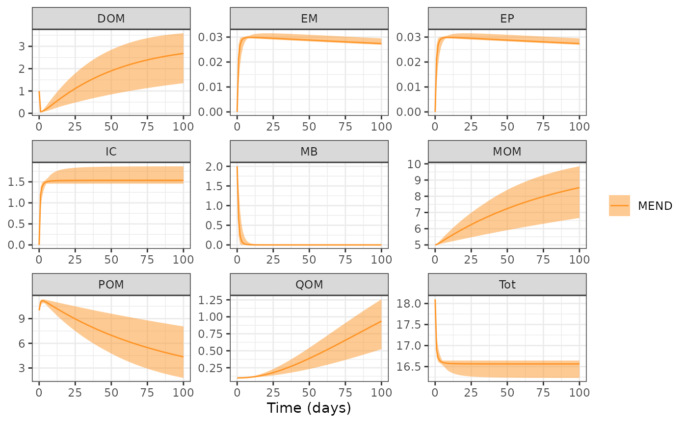

# Global Sensitivity

The objective of this example is demonstrate how to use `memc_sensrange`
to conduct a global sensitivity analysis and visualize the results to
demonstrate package capabilities.

The `memc_sensrange` function is a wrapper for `sensRange` from the FME
package, designed to help `memc` users easily perform an analysis to
estimate the global effect of `memc` parameter or initial condition on
model output. The official
[FME](https://cran.r-project.org/web/packages/FME/FME.pdf) provides more
details, but in short, `memc_sensrange` runs a memc configuration using
parameter combinations drawn from some predefined distribution, running
the model with each of these parameter combinations producing an
envelope of model results.

Start by loading the packages used in the demonstration.

``` r
library(MEMC) 


library(ggplot2)
theme_set(theme_bw())
```

Select the `memc` parameters or initial conditions to include in the
local sensitivity analysis. Any of the parameters included in
`memc_params` or `memc_initial_state` may be considered. In this example
we will consider how the memc MEND configuration is sensitive to $V_{d}$
and $K_{d}$, the maximum and half saturation rates of DOM decomposition.

Set up a data frame of the parameter range to sample from, here we
arbitrarily set the upper and lower bounds as $\pm$ 50% of the default
parameter value.

``` r
pars <- c("V_d" = 3.0e+00,"V_p" = 1.4e+01,"V_m" = 2.5e-01)
prange <- data.frame(min = pars - pars * 0.5,
                     max = pars + pars * 1.5)
```

``` r
MENDsens_out <- memc_sensrange(config = MEND_config,   # memc configuration
                               t = 0:100,              # the time steps 
                               x = pars,               # default parameter values
                               parRange = prange,      # parameter range to sample from
                               dist = "latin",         # sampling distribution to use, "latin" hyper cube or "norm"al 
                               n = 50)                 # the number of model runs/parameters to sample
```

The returned data frame includes the mean, standard deviation, range,
and several interquartile values for the organic material pools.

``` r
head(MENDsens_out)
#>   name time     Mean        Sd      Min      Max      q05      q25      q50
#> 1 MEND    0 10.00000 0.0000000 10.00000 10.00000 10.00000 10.00000 10.00000
#> 2 MEND    1 10.99332 0.2097380 10.53076 11.27360 10.60739 10.84239 11.04808
#> 3 MEND    2 11.16929 0.1334032 10.82295 11.33956 10.90632 11.10995 11.18340
#> 4 MEND    3 11.15270 0.1108076 10.90445 11.34554 11.00212 11.07543 11.15764
#> 5 MEND    4 11.07938 0.1389218 10.82958 11.31549 10.86812 10.97690 11.07309
#> 6 MEND    5 10.98552 0.1791477 10.64785 11.27724 10.69858 10.84779 10.97733
#>        q75      q95 variable
#> 1 10.00000 10.00000      POM
#> 2 11.16067 11.24182      POM
#> 3 11.27091 11.33303      POM
#> 4 11.23717 11.31877      POM
#> 5 11.19004 11.28761      POM
#> 6 11.13858 11.25661      POM
```

Quickly visualize results with the ribbon bounds controlled by the lower
and upper bound arguments.

``` r
plot(MENDsens_out, lower = "Min", upper = "Max")
```


